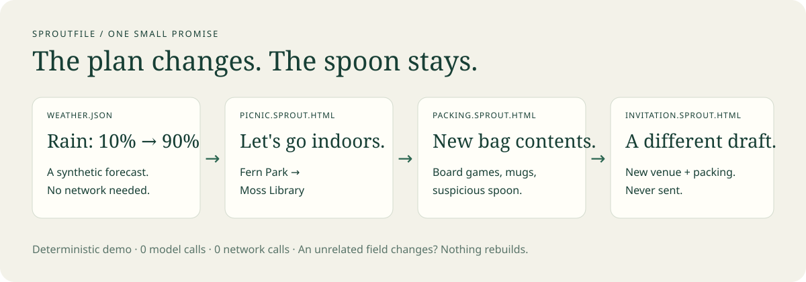

# ✳ Sproutfile

[](https://github.com/varadganjoo/sproutfile/actions/workflows/ci.yml)

### What if an AI output could keep a tiny promise?

An agent makes you a plan. The world changes. The plan usually just sits there.

**Sproutfile is a small experiment in giving the output a future.** A `.sprout.html` is a readable document containing its purpose, declared sources, update recipes, last values, and a short change history. A local runtime can continue it later. Another agent can pick up its unfinished prose without needing the original chat.

Today we are teaching a picnic to survive rain. Please calibrate your expectations accordingly.



## Try the ridiculous little demo

Python 3.11+. No API key, dependencies, model download, or installation needed.

```sh
git clone https://github.com/varadganjoo/sproutfile.git
cd sproutfile
python -m sproutfile demo
```

Open `sprout-demo/invitation.sprout.html` in your browser. Compare it with `sprout-demo/before/invitation.sprout.html`.

The demo creates three files, changes a synthetic forecast from dry to rainy, and actually refreshes them:

| Before | After |
| --- | --- |
| Fern Park, outdoors | Moss Library, indoors |
| Blanket, sunscreen, cups | Board games, mugs |
| Invitation with the old plan | Invitation with the new plan |

The suspiciously large spoon survives both timelines. The invitation is a draft and is never sent. The library is fictional; nothing is booked.

Then the demo changes a source field nobody uses. **Zero blocks rebuild.** The demo uses deterministic recipes: **0 model calls, 0 network calls**, rather than prerecorded model responses. Inspect `sprout-demo/demo-result.json` for the actual changes.

To keep playing:

```sh
python -m sproutfile --root sprout-demo watch invitation.sprout.html
```

Edit `sprout-demo/weather.json`, setting `rain_chance` back to `0.1`. The three files return outdoors. Reload your browser to see the new snapshot. Stop the foreground watcher with Ctrl+C.

## The interesting part: the next agent can continue the file

A recipe can contain an `agent` block. When a declared input changes, Sproutfile emits a job with the purpose, prompt, current inputs, and their hash. Give that job to your existing coding agent. It returns prose and source quotations; `submit` refuses a response for an older input hash.

```sh
python -m sproutfile --root examples create examples/agent-note.spec.json note.sprout.html
python -m sproutfile --root examples trust note.sprout.html
python -m sproutfile --root examples jobs note.sprout.html
```

Ask an agent to write `proposal.json` according to the emitted job and [continuation protocol](docs/AGENT_PROTOCOL.md). Then:

```sh
python -m sproutfile --root examples submit proposal.json
```

Change `examples/facts.json` and request jobs again. The old prose remains readable until a valid new proposal arrives. No paid service is needed by the runtime; the cost of whichever agent you choose is separate.

If you already run an installed local Ollama model, you can opt in to inference instead:

```sh
python -m sproutfile --root examples refresh note.sprout.html --model YOUR_INSTALLED_MODEL
```

This calls Ollama on `127.0.0.1:11434`. It does not install models. The manual agent handoff was exercised with agent-authored text; the Ollama adapter is currently **unverified with live inference**.

## What's in the file?

| Travels with the document | Stays on your machine |
| --- | --- |
| Purpose and source paths | Permission to read those sources |
| Block recipes and input hashes | Your chosen model and inference service |
| Last readable values and up to 20 updates | Foreground watcher process |
| Source quotations for agent blocks | Local grant store |

The HTML has an inert JSON payload and no executable JavaScript. Opening it only shows the last snapshot. **The file needs a runtime or an agent to change.** Moving the file preserves its recipe, but you must provide its sources and trust it in the new folder.

Only the blocks whose recipe or selected inputs changed are evaluated. Files can read other Sproutfiles, so changes propagate through a dependency graph. A copied or modified cache is recomputed after local trust. See the [format](docs/FORMAT.md) for a complete small recipe.

## Small on purpose, ambitious in direction

The experiment is about the unit an agent hands back: a useful output that carries enough information to be continued, rather than leaving all responsibility in a chat or hosted bot.

Active documents, reactive computation, build graphs, agent memory, and scheduled agents all have substantial prior art. **We did not invent those ideas.** The hypothesis here is that combining a readable portable file, selective updates, explicit local trust, and a model-independent continuation protocol makes ongoing outputs easier to own and exchange. We have not established global novelty or measured adoption. [Research notes and closest neighbors →](docs/PRIOR_ART.md)

## Current edges

- Local JSON and other Sproutfiles only. No live weather, accounts, browser control, email, or remote connector integration.
- Five block types: `value`, `table`, `choose`, `template`, `agent`. Recipes cannot run shell commands or arbitrary Python.
- Prose quotes must match the supplied inputs. **That does not prove every sentence is true.** Review generated text before using it.
- Updates use per-file atomic replacement and a folder lock. A multi-file refresh is **not** a crash-atomic transaction. External editors can still race a write.
- No background daemon, automatic source discovery, semantic dependency inference, or rollback command. Retained history is for inspection.
- Experimental format, no compatibility promise yet. [Limits and trust model →](docs/LIMITS.md)

## Build with us

Useful next experiments: an itinerary that survives a canceled train, a handover note that survives a release, a reading guide that marks the sections affected by a new paper. What should a file promise to maintain—and when should it stop and ask a person?

See the [roadmap](docs/ROADMAP.md), [contributing guide](CONTRIBUTING.md), and [agent integration instructions](docs/AGENT_PROTOCOL.md).

```sh
python -m unittest discover -s tests -v
```

MIT licensed. A garden shed, currently containing one very determined picnic.
